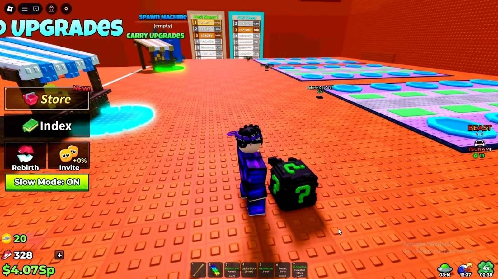
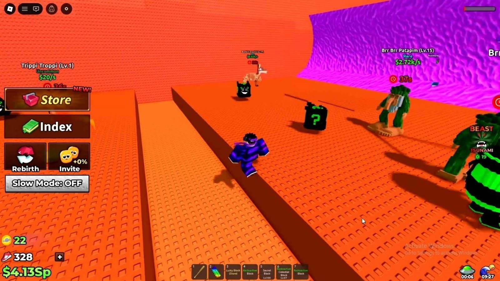
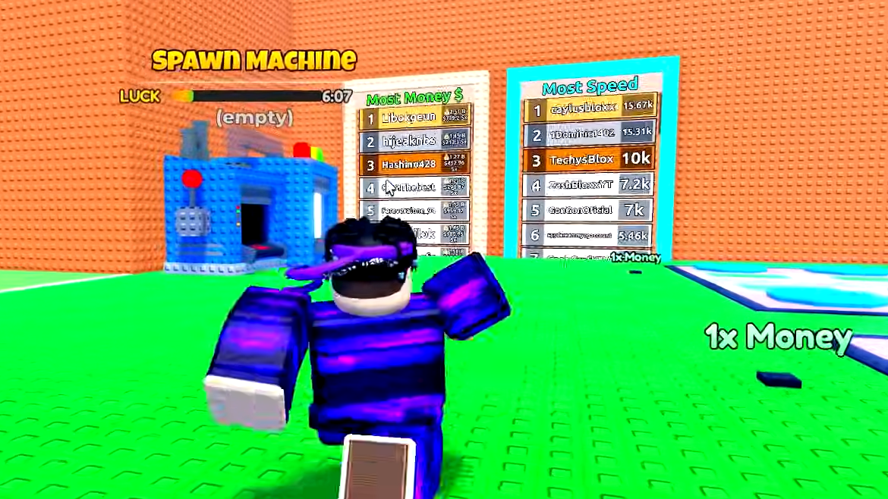

# בדיקת מחקר: משחק דומה לשלנו

**נבדק בתאריך 22/10/2026. זהו מחקר ראשוני על משחק אחד, ולא שינוי למסמך המשחק המאושר.**

## התוצאה

הצלחתי לאסוף נתוני פעילות ישירות מתוך Roblox, לבדוק מקורות נוספים, להוריד שלוש תמונות מתוך gameplay, לפתוח ולנתח אותן ולשמור אותן עם פרטי המקור. לא היה צורך בניתוח וידאו לצורך הבדיקה החזותית הזאת.

## המשחק שנבחר ולמה

[Escape Tsunami For Brainrots!](https://www.roblox.com/games/131623223084840/Escape-Tsunami-For-Brainrots), של Wave of Brainrots.

לפי תיאור היוצר ומדריכי המשחק, אוספים דמויות, נושאים אותן וחוזרים לבסיס תוך התחמקות מגלים. זו התאמה למתח המרכזי אצלנו: להמשיך לאסוף או לחזור למקום בטוח. הסיווג הרשמי הוא Simulation / Tycoon; זו השוואה למכניקות, לא קביעה שהמשחקים שייכים לאותה קטגוריה בדיוק.

אצלנו מפקידים מטען תמורת מטבעות לפני סגירת המחסן. במשחק שנבדק הדמויות המוצבות בבסיס מייצרות הכנסה מתמשכת, והאיום הוא גלים. לא אומת בו כלל האטה שתואם להאטה אצלנו.

## עדות להצלחה בהיקף השימוש

הנתונים הבאים התקבלו מתוך [נתוני Roblox הציבוריים](https://games.roblox.com/v1/games?universeIds=9363735110) בבדיקה הזאת:

| מדד | תוצאה |
| --- | --- |
| שחקנים בו־זמנית ברגע המדידה | 4,474 |
| ביקורים מצטברים | 5,737,757,320 |
| סימוני מועדפים מצטברים | 2,073,143 |
| מספר שחקנים מרבי לשרת | 8 |

ביקורים אינם מספר אנשים ייחודיים. המדידה הרגעית אינה ממוצע או שיא. הנתונים מראים היקף שימוש גדול; הם אינם מוכיחים רווחיות, דירוג ראשון בקטגוריה או מדוע המשחק הצליח.

גם [OP.GG](https://op.gg/roblox/games/9363735110) הציג כ־5.7 מיליארד ביקורים, אך נתוני הפעילות שלו היו שונים. זהו מקור נוסף להצגת הנתונים, לא מדידה עצמאית מהמקור של Roblox; הנתונים הישירים הם הבסיס למספרים כאן.

## מה ראיתי בתמונות

שלוש התמונות נפתחו ונבדקו חזותית. אלו תמונות שמפרסמים חיצוניים מציגים כצילומים מתוך המשחק. תאריך הצילום והגרסה המדויקת אינם ידועים; עמודי המדריכים מתוארכים לינואר ולפברואר 2026. הן רפרנס היסטורי, ולא הוכחה למראה המשחק כיום.

### הבסיס והנשיאה

**תצפית:** משטחים וקירות פשוטים, צבעים חזקים, שלטי שדרוג גדולים ופריט שנראה לצד הדמות. תפריטים גדולים תופסים חלק מהמסך.

**משמעות אפשרית עבורנו:** אפשר לבחון סגנון גאומטרי פשוט עם הבחנה ברורה בין אזורים ופעולות. התמונה אינה מוכיחה שסגנון כזה זול לפיתוח או שהוא הסיבה להצלחה.

מקור: [מדריך LDPlayer](https://www.ldplayer.net/blog/escape-tsunami-for-brainrots-roblox-guide.html?n=60000), מאת Nipun Gimhan, מתאריך 26/01/2026.

### אזור האיסוף והאיום

**תצפית:** גל סגול גדול, רצפה כתומה ושקע צר מפרידים בין צורות וצבעים. מעל פריטים מוצגים שם, דרגת נדירות, ערך וזמן.

**משמעות אפשרית עבורנו:** כדאי לבדוק בהמשך אם השחקן מזהה בתמונה אחת את השלל, האיום ודרך החזרה. פרטים רבים מעל כל חפץ עשויים ליצור עומס; זו השערה לבדיקה, לא בעיה שהוכחה כאן. אין בתמונה הוכחה למהירות הגל או להתנהגות המחסה.

מקור: אותו מדריך LDPlayer. אלו שתי זוויות של רפרנס אחד, לא שתי עדויות עצמאיות.

### מכונת ההגרלה והצגת ההתקדמות

**תצפית:** מכונה גדולה, מד התקדמות ולוחות דירוג בולטים בסביבה פשוטה. צילום זה מציג זווית קרובה; הוא אינו מציג את כל הממשק.

**משמעות אפשרית עבורנו:** יש רפרנס להצגת יעד מתמשך בתוך העולם. אין בכך המלצה להוסיף מכונה, הגרלות או לוחות דירוג למשחק שלנו.

מקור: [All Things How](https://allthings.how/escape-tsunami-for-brainrots-all-events-and-spawn-mechanics/), מאת Pallav Pathak, עודכן בתאריך 05/02/2026. באתר מיוחס הצילום ל־Roblox דרך YouTube/@ViewSIM. הסרטון המקורי לא נצפה ותאריך הפריים אינו ידוע. דמיון בין הצילומים אינו מאפשר להניח שמקורות הצילום עצמאיים.

## מה אפשר ללמוד על מודל ההכנסות

[רשימת game passes ציבורית](https://apis.roblox.com/game-passes/v1/universes/9363735110/game-passes?passView=Full&pageSize=100) התקבלה בהצלחה. ברשימה שנבדקה היו 10 מוצרים למכירה, ללא עמוד המשך. דוגמאות למחירים שהוחזרו: VIP במחיר 175 Robux, מגן קבוע במחיר 295 Robux, וכלי לאיסוף מרחוק במחיר 640 Robux. מחירים אלה אינם הבטחה למחיר שיוצג לכל שחקן.

אפשר לאמת הצעות למכירה ותיאורי יתרונות. לא התקבלו נתוני מכירות, הכנסה בפועל או רווח. [BloxBunny](https://bloxbunny.com/games/9363735110/escape-tsunami-for-brainrots) מציג הערכת הכנסה המבוססת על מודל; היא לא אומתה, ולא שימשה כאן לקביעה שהמשחק רווחי. רשימת game passes אינה מיפוי מלא של כל מקורות ההכנסה.

## מה בדיקת ההיתכנות הוכיחה

| פעולת מחקר | מה בוצע ומה הגבול |
| --- | --- |
| מציאת משחק דומה עם היקף שימוש גדול | בוצע, על בסיס התאמה במכניקות ונתונים ציבוריים. לא בוצע דירוג של כלל המתחרים. |
| קריאת נתונים ציבוריים ומוצרים למכירה | בוצע מול שני שירותי Roblox; תוצאות המקור נשמרו מקומית. |
| איתור, הורדה וניתוח תמונות gameplay | בוצע עבור 3 תמונות מ־2 אתרי תוכן. שתי תמונות בגודל 1600×900 ואחת בגודל 1170×658. |
| שמירת רפרנסים לשימוש חוזר | בוצע לפי משחק ונושא, עם מקורות ותאריכים. |
| הבנת תנועה, אנימציה וקצב | לא נבדקה. התמונות אינן מספיקות לכך. יכולת ניתוח וידאו לא אומתה. |
| בדיקת הנאה, ביצועים והיתכנות המימוש שלנו | לא בוצעה. לא שוחק המשחק ולא הופעל Studio. |
| מדידת חיסכון במשאבים ובטוקנים | לא בוצעה. אין כאן הוכחה כמותית לחיסכון לעומת וידאו. |

פתיחת כתובות התמונות דרך כלי החיפוש נכשלה. הורדה ישירה של אותן תמונות ופתיחת הקבצים המקומיים הצליחו. זו הוכחה למסלול עבודה זמין בבדיקה הזאת, ולא הבטחה שכל אתר יאפשר הורדה.

## איפה החומר נשמר

התמונות, פרטי המקור ותגובות הנתונים שמורים מקומית בתיקייה `references/competitors/escape-tsunami-for-brainrots/`. התיקייה נכללת כעת ב־Git באישור אדם מתאריך 26/10/2026. המסמך הזה ותצוגת הקריאה נשמרים בתוך Git, וכוללים קישורים למקורות. התמונות בתצוגת הקריאה נטענות מהעותקים המקומיים שבמאגר. קישורי המקור נשמרו לצורך ייחוס ובדיקה; הצגת התמונות אינה תלויה בהורדה חוזרת מהרשת.

הממצאים הם בסיס לדיון על רמת הבהירות וההצגה הרצויה. הם אינם משנים את ה־spec המאושר ואינם אישור למימוש.
