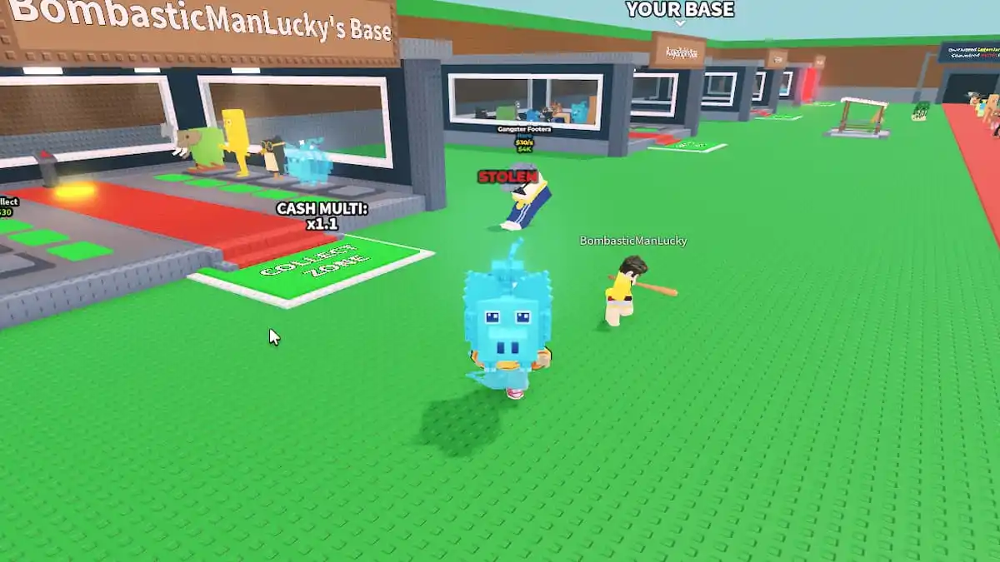
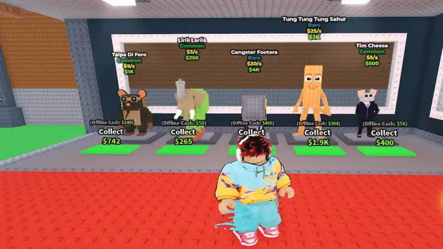

# רפרנס חזותי: Steal a Brainrot

**נבדק בתאריך 22/10/2026. צילומי gameplay היסטוריים; לא נערך משחק ישיר.**

## למה נבחר

[Steal a Brainrot](https://www.roblox.com/games/109983668079237/Steal-a-Brainrot), של BRAZILIAN SPYDER. לפי תיאור היוצר קונים או גונבים דמויות ובונים הכנסה בבסיס. הנשיאה חזרה לבסיס רלוונטית לנו; PvP, גניבה והכנסה מתמשכת אינם הכללים שלנו.

## נתוני שימוש וזהות

נתוני [Roblox הציבוריים](https://games.roblox.com/v1/games?universeIds=7709344486) החזירו 112,143 שחקנים בו־זמנית ו־74,089,275,225 ביקורים מצטברים. מזהה universe: 7709344486. זו מדידה רגעית אחת מ־22/10/2026, לא ממוצע, דירוג רווחיות או מספר שחקנים ייחודיים. זמן קובץ התגובה ב־UTC: 2026-10-22T13:10:41.418740+00:00.

## מה נראה בפועל

**תצפית:** בסיסים חוזרים בצורתם, רצפה ירוקה, נתיב אדום, שלט בסיס אישי ודמות נושאת פריט גדול. התנועה עצמה אינה מוכחת בצילום.

**משמעות עבורנו:** דרך החזרה והבסיס צריכים להיות מזוהים מתוך זווית המשחק. המטען צריך להיות נראה בלי להסתיר את הנתיב.

**תצפית:** לכל דמות מקום נפרד, משטח ירוק ותוויות ערך. הצורות פשוטות, והתוויות בולטות באמצעות ניגוד צבע וגבול כהה.

**משמעות עבורנו:** פעולה חשובה צריכה להיות קשורה למקום ברור בעולם. אין לאמץ את מספר התוויות אוטומטית; אצלנו נבדוק שאין חפיפה בזוויות הרחוקות.

מקור לשתי התמונות: [Pro Game Guides](https://progameguides.com/roblox/how-to-steal-and-defend-in-steal-a-brainrot-pvp-base-protection-tips/), Vignesh Raja, עודכן ב־17/07/2025; קרדיט צילום לאתר. תאריך הצילום והגרסה אינם ידועים. תמונת הבסיס מופיעה בראש הכתבה אך מציגה scene מתוך המשחק, ולא פוסטר. הטקסט המקדים בעמוד מזכיר בטעות משחק אחר; התוכן, כיתובי התמונות והתיאור הרשמי נבדקו בנפרד.

## מגבלות ושמירה

לא נראה HUD מלא בכל צילום. אין ראיה מכאן לאיכות touch, אנימציה, ביצועים או מראה עדכני. אלו שתי תמונות של מפרסם אחד, לא שתי עדויות עצמאיות. הרפרנסים נשמרו תחת references/competitors/steal-a-brainrot עם manifest ותגובות נתונים; התיקייה נכללת כעת ב־Git באישור אדם מתאריך 26/10/2026. אלו חומרי מחקר בלבד.

[חזרה למפת ההשוואה החזותית](visual-benchmark.md).
