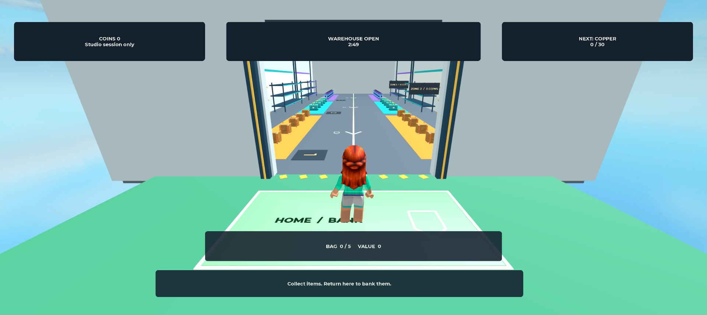
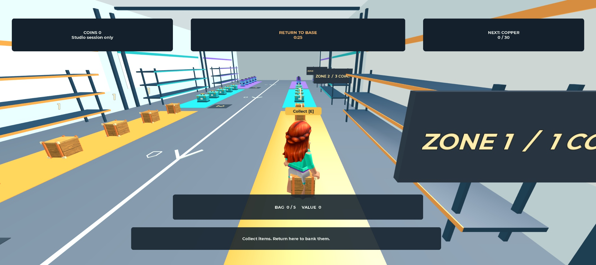
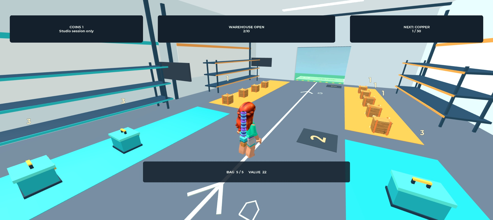
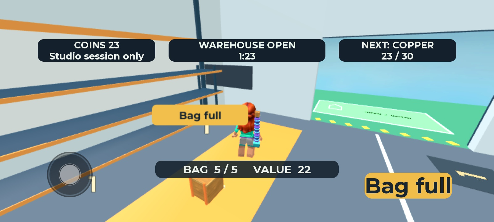
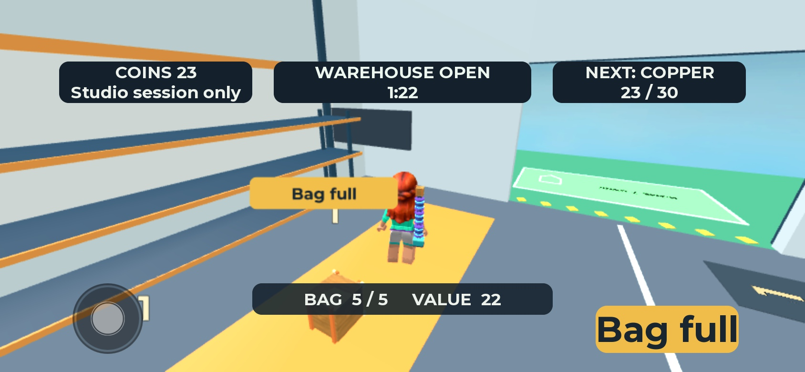
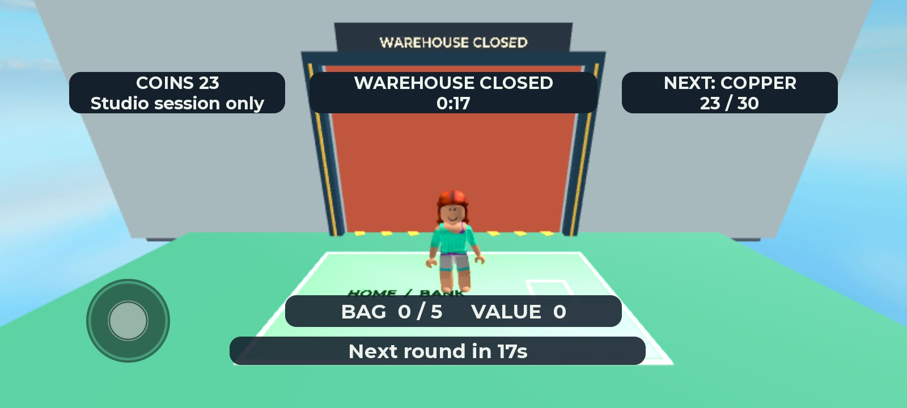

# V1 — בדיקה חזותית מול שלושת הרפרנסים

**מצב בתאריך 24/10/2026: השינוי מומש וצולם. ההשוואה בוצעה; הקבלה החזותית הכוללת עדיין פתוחה.**

אדם אישר את הכיוון המתוקן ואת המשך המימוש. חסימת הצילום נפתרה בהיקף הבדיקה הנוכחי. לא ממשיכים לבדיקות השחקנים לפני סגירת הקבלה החזותית, לפי סדר הבדיקות שנקבע.

הדרישות נמצאות בתוך [בדיקת הגרפיקה](../specs/v1/visual-quality.md) ובתוך [עמידה ברמת המתחרים](../specs/v1/competitive-review.md). [מפת הרפרנסים](visual-benchmark.md) מקשרת למקורות ולתאריכי האיסוף. נפתחו שוב תמונות gameplay משלושת המחקרים:

- [Escape Tsunami](escape-tsunami-for-brainrots.md) — משטחי בסיס וחפץ נישא.
- [Steal a Brainrot](steal-a-brainrot.md) — חפץ נישא ובסיסים מזוהים.
- [Survive LAVA](survive-lava-for-brainrots.md) — צורת חפצים, צבעים ותוויות ערך.

## צילומים חדשים מהמשחק — 24/10/2026

הצילומים הבאים הם מהמימוש החדש, באותו חלון Studio. הם מחליפים את חסימת הצילום שצוינה בעדכון הקודם. המקורות המקומיים של שלושת המתחרים נפתחו שוב לצד הצילומים החדשים. מקור כל רפרנס ותאריך האיסוף נשארים מתועדים במסמכי המחקר המקושרים כאן; אין טענה שהם מייצגים את הגרסה העדכנית ביותר של המתחרה.

בצילום החזרה המצלמה הוצבה לצורך בדיקה באמצעות MCP. הוא מוכיח את מראה המטען והדרך בזווית הזאת; אינו מוכיח נוחות סיבוב מצלמה.

## מה השתנה מול הרפרנסים

| תחום ורפרנס | מה נראה עכשיו | מה עדיין לא הוכח |
| --- | --- | --- |
| חלוקת צבעים ומשטחי פעולה — Escape Tsunami | שלושה פסי אזור מובחנים, מסגרת כניסה ובסיס ירוק בעל מסגרת. המסלול המרכזי נשאר רגוע ומופרד | אין בדיקה אנושית של זיהוי הדרך. המראה אינו העתק של בסיסי השדרוג ברפרנס |
| חפץ שנישא ליד הדמות ויעד חזרה — Steal a Brainrot | ארגז, מזוודה ומכל מופיעים גם במטען, והבסיס נראה דרך הכניסה | המטען אצלנו קטן ודק ביחס לחפץ הבולט ברפרנס. בנייד פרטי המשפחות פחות ברורים; אין אישור שההבחנה מספקת במבט מהיר |
| צורה, צבע וערך — Survive LAVA | שלוש צלליות ומספר צבעים בכל חפץ, במקום קוביות זהות. המזוודה רחבה והמכל גבוה וגלילי | לרפרנס דמויות גדולות ובעלות אופי בולט. החפצים שלנו תעשייתיים ופשוטים יותר. לא הוכח שכוח המשיכה שלהם שווה לרפרנס |
| קריאות המידע בנייד | המטבעות, זמן המחסן, הקיבולת והערך נראים בשני צילומי הנייד. כפתור Bag full מופרד מהמידע הראשי | תווית החפץ בעולם יכולה להתקרב לדמות בזווית הבדיקה. אין כאן כיסוי לכל זווית, touch מלא או מכשיר אמיתי |

**תוצאת ההשוואה החדשה:** המחסור המקורי בשינוי צורה, גודל וצבע טופל ונראה בפועל. ההשוואה הכוללת נשארת פתוחה, במיוחד בולטות המטען בנייד והאופי החזותי מול חפצי המתחרים. אין בסיס לקביעה שבסבירות גבוהה שחקן יבחר במשחק שלנו. לא מסמנים קבלה מלאה ולא עוברים לבדיקות אנושיות על סמך הצילומים בלבד.

## הבדיקה הקודמת — 23/10/2026

אדם דחה את המראה הקודם בגלל מחסור בצבעים ובצורות וחפצים פשוטים מדי. [צילום המטען הישן](evidence/v1/images/desktop-cargo-after.png) נשמר לצורך השוואה. הוא אינו מייצג את המימוש החדש. תוצאות הקוד הקודמות אינן מחליפות קבלה חזותית.

התחלה ללא תפריטים, מסלול קצר ובחירה בין האטה לחזרה הם סיבות סבירות לבדוק את המשחק. tests אינם מוכיחים שהחוויה מעניינת שחקן או עדיפה על המתחרים. אין עדיין תצפית אנושית שמוכיחה העדפה. [דוח הבדיקה](v1-validation.md) מפרט את הבדיקות שבוצעו ואת המגבלות.
