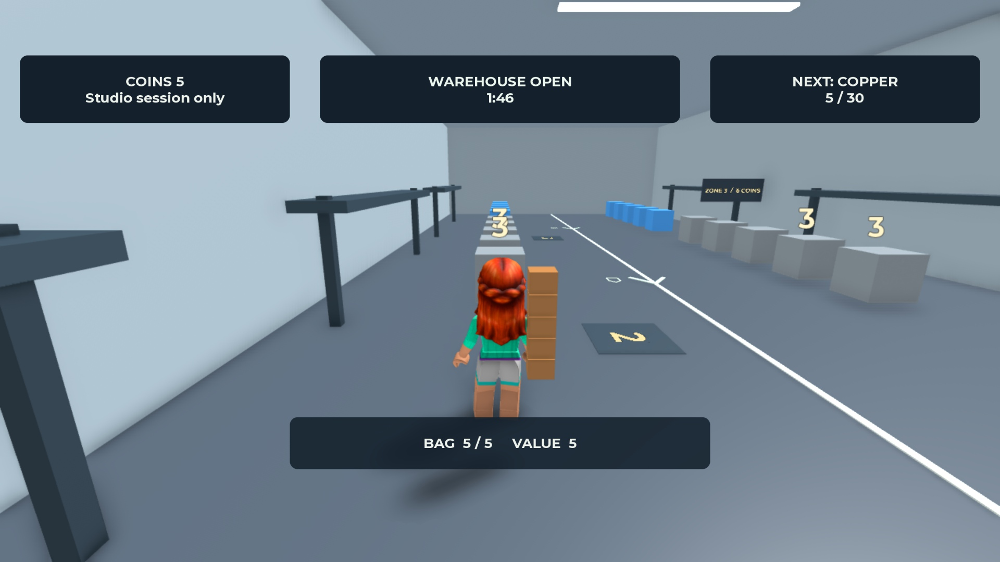

# V1 — בדיקה חזותית מול שלושת הרפרנסים

**המראה הקודם: לא עבר, לפי החלטת אדם בתאריך 23/10/2026. המראה המתוקן: מומש, אך ההשוואה החזותית טרם הושלמה.**

אדם זיהה מחסור בגיוון צבעים וצורות ופשטות גבוהה מדי של החפצים. בדיקת ההעדפה ושאר בדיקות הקבלה נעצרות עד שהמראה המתוקן יעבור השוואה חוזרת. הראיות הטכניות שנאספו נשמרות; הן אינן אישור לרמה החזותית.

המקור לדרישות הוא [בדיקת הגרפיקה](../specs/v1/visual-quality.md) וכן [עמידה ברמת המתחרים](../specs/v1/competitive-review.md). פרטי המקורות והתאריכים נמצאים בתוך [מפת הרפרנסים](visual-benchmark.md). התמונות שנאספו בתאריך 22/10/2026 נבדקו שוב לצורך ההשוואה. גרסת המשחק ותאריך הצילום שלהן אינם ידועים; לא בוצע משחק ישיר אצל המתחרים.

## ראיה שלנו והיקפה

צילום Studio של המשחק שלנו, 23/10/2026. התמונה שנשמרה היא 1920 על 1080. חמישה חפצים נישאים מאחורי הכתף; הראש והגוף נראים. המסלול והחץ נראים לצד הדמות. המידע העליון מופרד מהשילוט בעולם. צילום זה קדם לתיקון מרחק הפתיחה ל־14 studs ולתיקון העברת רשימת החפצים; הוא מוכיח את השינוי הגאומטרי בלבד. אין לסמן באמצעותו את כל הגרסה הנוכחית כמאושרת.

## ההשוואה לכל רפרנס

| רפרנס מסוים | מה נצפה | מה נבדק אצלנו והפער |
| --- | --- | --- |
| Escape Tsunami — base-carry.jpg, מתוך [מחקר המשחק](escape-tsunami-for-brainrots.md) | משטחים גדולים, בסיסים מסומנים ומטען בולט ליד הדמות | גם אצלנו מטען נבדל מהדמות ומהרצפה ומספר החפצים מוצג. הצילום שלנו מראה את הדרך; עדיין נדרש צילום בסיס עדכני בנייד. אין להסיק על נוחות שליטה מהתמונה |
| Steal a Brainrot — carry-and-base.jpg, מתוך [מחקר המשחק](steal-a-brainrot.md) | נשיאה במרחב פתוח, בסיס מזוהה בטקסט ובמשטח מובחן | אצלנו הבסיס משותף והמסלול צר יותר לפי ההגדרות. נוספו סמל בית ושילוט משטח. נדרשת בדיקה מהכיוון של החזרה, גם עם מטען מלא, לפני קביעה שהדרך ברורה באותה מידה |
| Survive LAVA — value-and-rarity.jpg, מתוך [מחקר המשחק](survive-lava-for-brainrots.md) | ערך, נדירות וצבע בולטים בצילום קרוב | אצלנו ערכים 1, 3 ו־6 ותווית האזור מבחינים בערך, בלי להוסיף נדירות או חנות שלא אושרו. המידע המעט יותר מתאים להיקף שלנו; קריאות התוויות בכל גדלי הנייד עדיין דורשת בדיקה |

המחסן שלנו שומר על גאומטריה פשוטה וסגנון תעשייתי שאושר. צבעי הרפרנסים רוויים יותר, והדמויות האספניות שלהם שונות מהקוביות שלנו. אלה הבדלים נראים, ולא הוכחה שצבע או דמות מסוימים גורמים להצלחה. אין צורך להעתיק את היקף התוכן שלהם כדי לבדוק את V1.

## תוצאת הבדיקה כעת

| תחום | תוצאה |
| --- | --- |
| מטען שאינו מסתיר את הדמות | עבר בזווית המחשב המצולמת; נייד וזוויות ליד קיר טרם אומתו |
| טקסט עליון ושלטים | תוקן ונצפה במחשב; אין עדיין כיסוי לכל המסכים והסצנות |
| דרך חזרה, בסיס ואזורי ערך | סמלים, טקסט וחיצים מומשו; אישור חזותי מלא עדיין פתוח |
| איסוף, הפקדה, אזהרה וכישלון | ההתנהגות מופעלת במשחק; נדרשת השלמת תיעוד של כל מצבי הקבלה |
| קלט, אנימציה, משך תגובה ויציבות | תמונות אינן מוכיחות אותם. המקור הוא בדיקות המשחק ודוח הביצועים |

## האם לבחור במשחק שלנו

**אין מספיק ראיות להמליץ לבחור בו על פני המתחרים.** ההתחלה ללא תפריטים, המסלול הקצר והבחירה בין האטה לחזרה הם סיבות סבירות לבדוק אותו. קיימים tests שמוכיחים שהכללים עובדים, אך הם אינם מוכיחים שהבחירה מעניינת שחקן או שהמראה מושך יותר מהרפרנסים.

אין עדיין תצפית של שחקן אנושי שבחר במשחק, הבין את הסיכון או רצה להמשיך. סף ההעדפה החדש דורש אישור אדם לפני ניסוי, כפי שנקבע במסמך המקור. לא ניתן להציג סבירות גבוהה לבחירה או עמידה כוללת ברמת המתחרים לפני סגירת הפערים.

## מצב השינוי שאושר — 24/10/2026

שלוש משפחות דגמים מפורטות שולבו במחסן ובמטען. נוספו צבעי אזורים ופרטי סביבה לפי הכיוון שאושר. [דוח הבדיקה](v1-validation.md) מתעד tests שעברו, וגם חסימת צילום מתוך המשחק. התמונות וההשוואות לעיל מתארות את המראה הקודם; הן אינן ראיה למראה החדש. אין עדיין תוצאה חזותית חדשה או אישור לעבור לבדיקת העדפה עם שחקנים.
